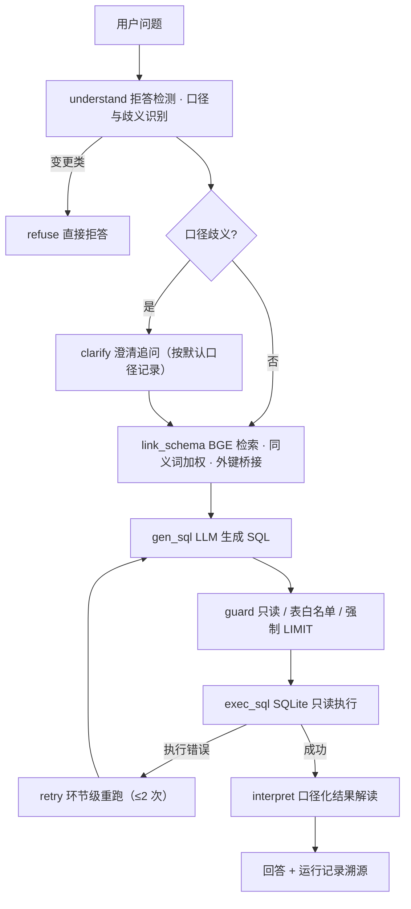

# 自主数据分析 Agent

面向业务取数与多步分析的 NL2SQL Agent：口径歧义主动澄清、Schema 语义检索、SQL 只读守卫、结果口径化解读，复杂问题由外层编排拆解为多步执行。

技术栈：Python 3.12 · LangGraph · SQLite / DuckDB · 自部署 Qwen3-Coder-Next（AWQ-4bit）+ Qwen3-Embedding-4B · FastAPI

## 项目来源

| 项 | 内容 |
|---|---|
| 选题方向 | 复杂数据分析：异构数据工作区上的取数、计算与结论生成 |
| 任务形态参照 | KDD Cup 2026 Data Agents（https://dataagent.top）的任务分类与基准形态 |
| 实现范围 | 单轮取数全链路（理解 / 链接 / 生成 / 守卫 / 执行 / 解读）＋ 多步编排与三技能（取数 / 沙箱计算 / 口径检索） |
| 自建内容 | 主业务库环境（Olist 9 表 / 约 155 万行）、指标口径体系与同义词配置、LangGraph 链路、多步编排、评测黄金集与全部评测脚本 |
| 外部评测 | BIRD Mini-Dev、CSpider、Archer、DataSpace 公测包（60 题，官方评测器判分） |

业务库为公开数据集，仓库不含数据本体，由 `scripts/fetch_data.py` 一键复原。

## 系统架构

单轮取数走固定链路，任一环节失败按环节级重跑，不整链回退；复杂问题由外层编排拆解后逐步执行。



多步编排为外层三段式：`plan → execute_step → synthesize`，三技能为 `query_data`（取数）/ `compute`（Python 沙箱计算）/ `search_doc`（口径文档检索），设计见 `docs/DataAgent升维设计.md`。

## 关键实现

**1. 口径先行：歧义在取数之前解决**

业务问题里的同名异义（含税 / 不含税、退款是否扣减、均值为均值还是中位数）由 `understand` 识别，命中歧义则走 `clarify` 追问并按默认口径记录；口径与同义词集中在 `config/`，是独立于代码的可迭代资产。

**2. Schema Linking：检索而非全量注入**

BGE 向量检索召回候选表与字段，叠加同义词加权与外键桥接补齐关联路径；召回抽检 11/11。嵌入后端经对照裁决（自部署 4B 21/23 vs BGE-small 19/23）。

**3. 执行安全：三层守卫**

只读连接、表白名单、强制 LIMIT 三道约束在 SQL 执行前生效；执行错误按环节级重跑并携带上一次错误信息，最多 2 次。

**4. 多步编排：技能化拆解**

`plan` 把复杂问题拆成带依赖的步骤，`execute_step` 逐步调用三技能（取数、沙箱计算、口径检索），`synthesize` 汇总为最终答案。30 条多步任务上，编排对照无规划基线净增益 +16 条 / +53.3pp。

**5. 迭代闭环：只改配置、不动代码**

失败归因后只调整 `config/` 资产（口径 / 同义词 / few-shot / 提示词），再跑回归对比。从 61/72 到 72/72 的全部变更记录在 `eval/CHANGELOG.md`。

**6. 规模与引擎实证**

真实分布放大 ×100 → 1,126.5 万行：全量聚合在 SQLite 上 6615.6 ms，切 DuckDB 后 7.1 ms；双引擎结果一致性 49/52 = 94.2%（`eval/report_scale_lab.md`）。服务化外壳 `service.py` 提供 `/v1/ask` 与 `/healthz`。

## 评测结果

| 评测项 | 数据来源 | 规模 | 结果 |
|---|---|---|---|
| 执行准确率（basic / join / filter） | 本工程自建黄金集 | 52 条 | **52/52 = 100%**（基线 41/52 → v0.1 49/52 → v0.2 52/52） |
| 澄清触发 / 拒答 | 同上 | 12 / 8 条 | **12/12** / **8/8** |
| 黄金集总体 | 同上 | 72 条 | **72/72** |
| 朴素基线对照（单次直出、无编排） | 同上 | 52 条 | 39/52 = 75.0% → 编排 + 口径层 **+13 条 / +25.0pp** |
| 多步任务（五类） | 自建多步集 `eval/multistep_tasks.jsonl` | 30 条 | 完成 **30/30**，最终答案 **28/30**（终版配置复跑区间 27–29） |
| 无规划基线对照 | 同上 | 30 条 | 12/30 → 编排 **+16 条 / +53.3pp** |
| BIRD Mini-Dev（全库 schema 模式） | [BIRD](https://bird-bench.github.io/)（[HuggingFace](https://huggingface.co/datasets/bird-bench/mini_dev)） | 498 题（11 库） | **272/498 = 54.6%** |
| CSpider（中文） | [CSpider](https://taolusi.github.io/CSpider/)（[GitHub](https://github.com/taolusi/CSpider)） | 814 题 | **559/814 = 68.7%** |
| Archer（中英双语，多跳反事实） | [Archer](https://github.com/ArcherText2SQL/Archer)（[HuggingFace](https://huggingface.co/datasets/ArcherText2SQL/Archer)） | 1012 题 | **238/1012 = 23.5%** |
| DataSpace 公测（KDD Cup 2026） | [dataagent.top](https://dataagent.top)；官方评测器（`eval/kdd_evaluator/`） | 60 题（异构工作区） | Task Accuracy **A 单发 14/60 = 23.3%**｜**B 取数+解读 12/60 = 20.0%** |
| 嵌入后端对照 | 本工程实验 | 23 条 | Qwen3-Embedding-4B 21/23 vs BGE-small 19/23 |

评测口径、失败归因与逐题明细见 `eval/BENCHMARKS.md` 及各评测报告；迭代记录见 `eval/CHANGELOG.md`。

## 版本演进

| 时间 | 内容 |
|---|---|
| 2026-04-06 | 主链路原型：单轮 NL2SQL 全链路、配置层、Schema Linking、72 条黄金集与评测脚本 |
| 2026-04-22 – 10-14 | 迭代闭环 v0.1 / v0.2 → 72/72；跨库外测 BIRD Mini-Dev |
| 2026-05-12 | 多步编排（Phase A–C）+ 三技能 + 30 条多步集；CSpider / Archer 外测；规模实验室与服务化外壳 |
| 2026-05-26 | DataSpace 公测轨（双链路）；嵌入后端对照与接线 |

## 工程结构

```
data-agent/
├── README.md / requirements.txt / app.py / webui.py / service.py   # 门面 / 依赖（锁版） / CLI、Web 演示与 HTTP 服务入口
├── docs/                                        # 工程文档
│   ├── 设计方案.md / 详细设计.md                 # 系统方案 / 模块级设计
│   ├── 施工说明书.md                             # 分阶段实施手册（环境 / 步骤 / 排错）
│   ├── 数据集说明.md / 模型选型.md               # 数据 / 模型角色与选型论证
│   ├── 编排形式审查_LangGraph.md                 # 图结构审查记录
│   ├── DataAgent升维设计.md                      # 多步编排与三技能设计
│   ├── 口径手册.md / 数据字典.md                 # 口径体系（search_doc 检索源）
│   ├── 生产化路线.md                             # 生产化差距矩阵与迁移路径
│   ├── 技术报告.md / .pdf                        # 技术方案（架构 / 实现 / 评测 / 复现）
│   ├── 开发过程.md                               # 分阶段工作记录与关键决策
│   └── 演示记录.md                               # 可复现运行演示与输出
├── config/                                      # 可迭代资产：口径 / 同义词 / 表说明 / 参数 / 提示词 / few-shot
├── data/                                        # raw / orders.db / profile.md / index/ / models/（不入库，脚本生成）
├── runs/                                        # 运行记录（trace）；samples/ 收录三路径样例
├── scripts/                                     # 数据 / 索引 / 文档 / 实验室
│   ├── fetch_data.py / build_db.py / profile_data.py
│   ├── fetch_model.py / build_index.py
│   ├── build_docs.py / build_doc_index.py        # 口径文档渲染与入库
│   └── check_linking.py / check_fewshots.py / scale_lab.py
├── src/                                         # 16 个模块：graph / orchestrator / skills / sandbox / guard / metrics …
├── eval/                                        # 评测与迭代（单步 / 多步 / 外测 / 规模）
│   ├── golden_set.jsonl / multistep_tasks.jsonl # 黄金集 72 + 多步任务 30
│   ├── run_eval.py / run_multistep.py / run_external.py / naive_baseline.py / validate_*.py
    ├── report_v1*.md / report_naive.md / report_multistep.md / report_external_*.md / report_scale_lab.md / report_kdd.md
    ├── BENCHMARKS.md                            # 跨基准汇总 + 口径说明
    ├── CHANGELOG.md                             # 迭代记录
    └── archive/ / external/                     # 过程报告留档 / 跨库外测明细
└── tests/                                       # 单元测试（SQL 守卫 / 计算沙箱 / 口径体系）
```

## 快速开始

```bash
python -m venv .venv && source .venv/Scripts/activate
pip install -r requirements.txt

python scripts/fetch_data.py        # 拉取数据集（约 560MB；已就绪自动跳过）
python scripts/build_db.py          # 构建 SQLite 主库（约 143MB）
python scripts/profile_data.py      # 数据画像 → data/profile.md
python scripts/build_index.py       # Schema / few-shot 索引

python app.py --mock "2018 年各州订单量排名？"   # 离线干跑（不调 LLM）
python -m src.graph                             # 全链干跑：澄清 / 重试 / 拒答 三路径
python -m streamlit run webui.py --server.port 8602   # Web 界面：场景快选 + 管线过程可视化
# 真实 LLM：复制 .env.example → .env，配置 LLM_*（任意 OpenAI 兼容端点）
python app.py "2018 年各州的销售额排名前五？"
```

## 运行评测

```bash
python scripts/check_linking.py     # Schema Linking 召回抽检
python scripts/check_fewshots.py    # few-shot 防泄漏 / 可执行校验
python eval/validate_golden.py      # 黄金集自检 + 答案缓存
python eval/run_eval.py             # 黄金集全量评测
python eval/naive_baseline.py       # 朴素基线对照
python eval/run_external.py         # BIRD Mini-Dev（支持 --limit / --db）
python scripts/build_docs.py && python scripts/build_doc_index.py
python eval/run_multistep.py        # 多步任务评测
python eval/kdd_prepare.py && python eval/run_kdd.py   # DataSpace 公测轨
python scripts/scale_lab.py         # 规模与引擎实验室（1,126.5 万行 / 双引擎一致性）
```

## 单元测试

```bash
python -m pytest                    # 66 条用例：SQL 守卫 / 计算沙箱 / 口径体系
python -m ruff check . && python -m ruff format --check .   # 风格检查（100 列，配置见 pyproject.toml）
python -m pytest tests/test_guard.py -v    # 仅看只读守卫
```

## 服务化

```bash
uvicorn service:app --host 0.0.0.0 --port 8000
curl -X POST http://127.0.0.1:8000/v1/ask -H "Content-Type: application/json" \
     -d '{"question": "2018 年各州订单量排名前五？"}'      # 加 "route": "multi" 走多步编排
```

## 数据与模型

数据本体、嵌入模型、索引均不入库，由 `scripts/` 复原；`.env`、`.venv`、运行记录（`runs/samples/` 除外）不入库。数据集来源、抽取结果与许可见 `docs/数据集说明.md`；依赖版本已在 `requirements.txt` 锁定。

## 许可

MIT License，详见 [LICENSE](LICENSE)。
