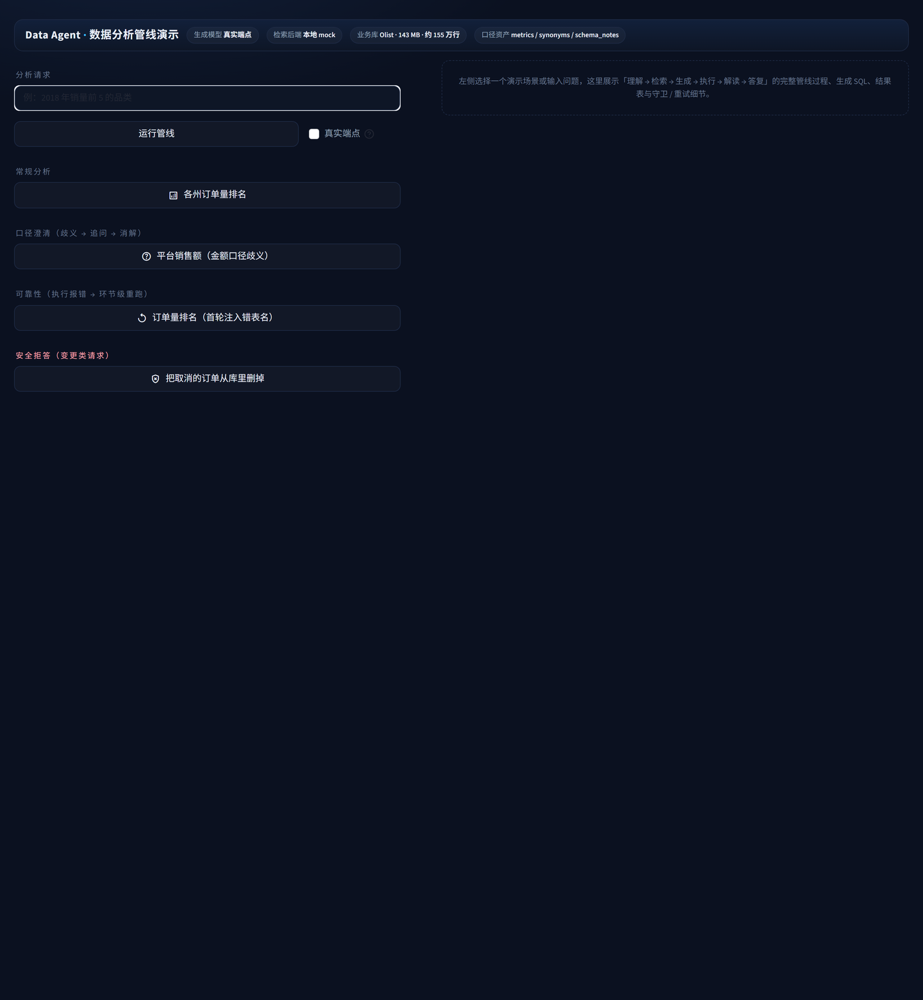
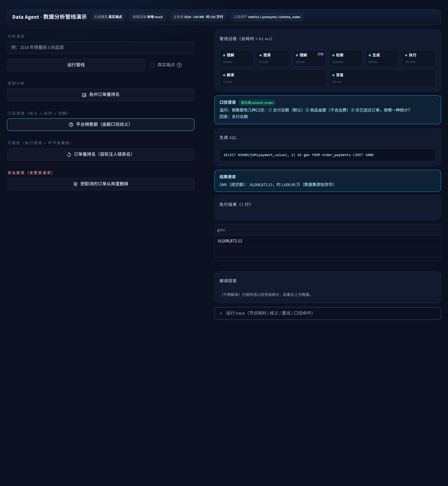
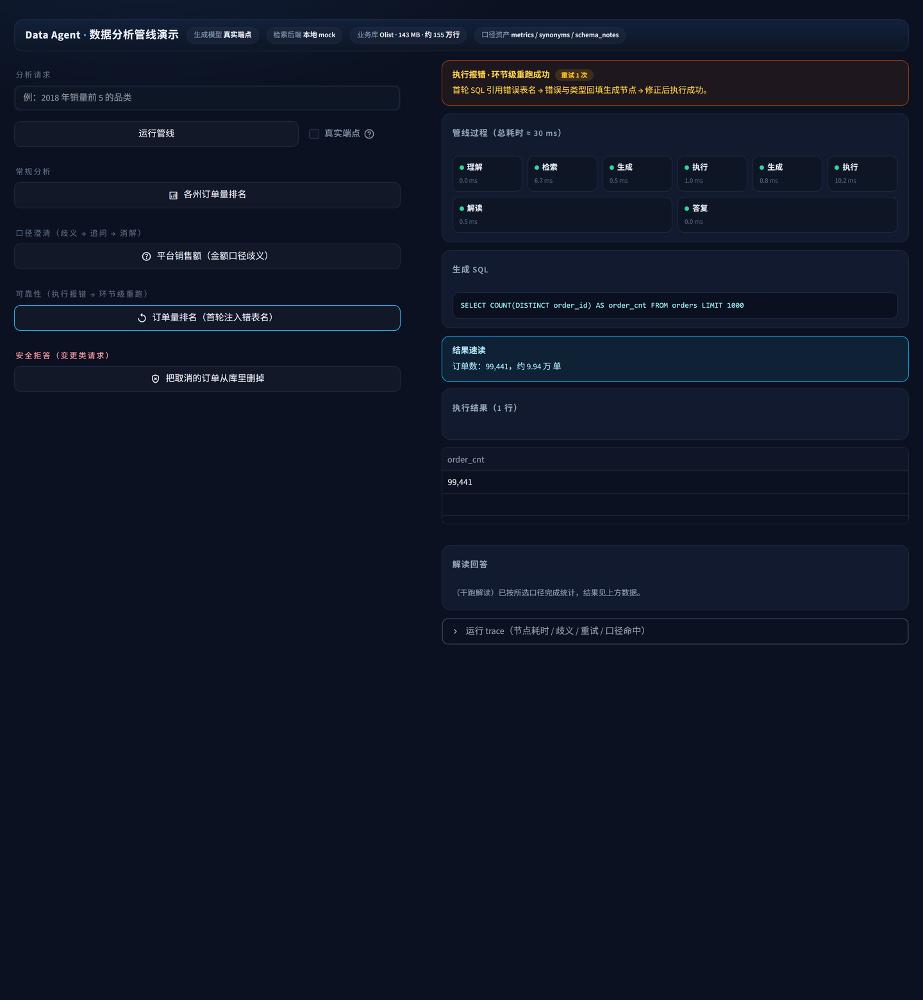
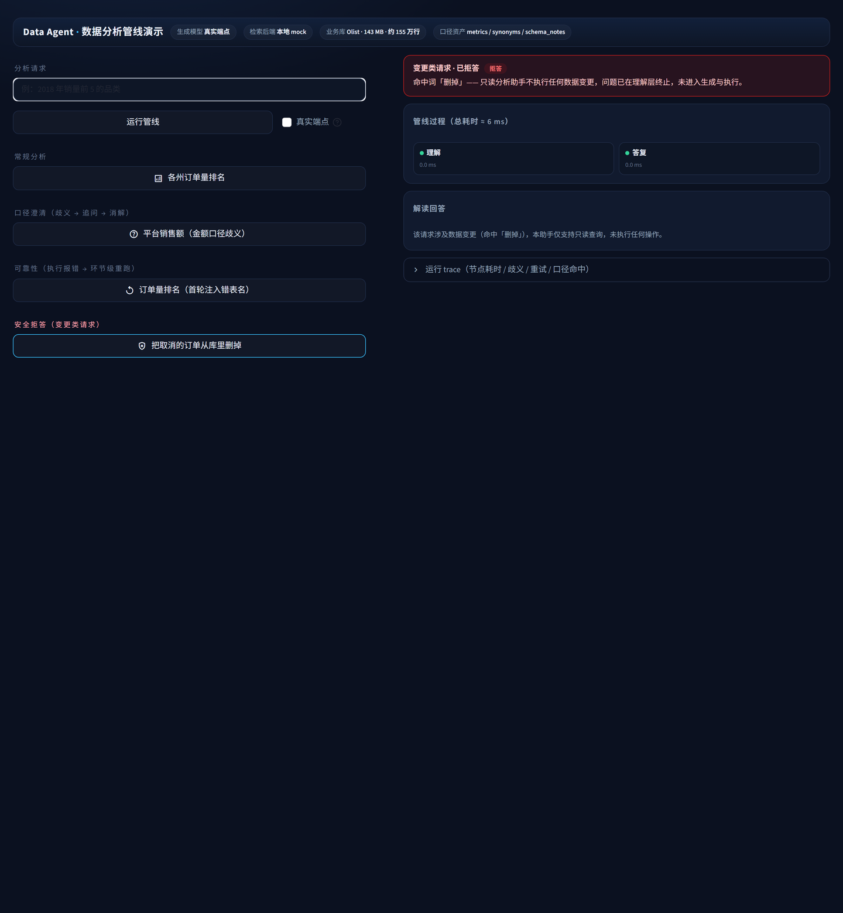

# 演示记录

> 本文件记录可复现的运行演示：命令、真实输出、运行记录结构。所有输出均为本机实际执行的粘贴，
> 未做修饰。标注「干跑」的部分使用离线 mock 实现，不调用外部服务。

## 1. 界面（Web 演示）

```bash
python -m streamlit run webui.py --server.port 8602
```

左栏为分析请求入口：四个场景快选（常规取数 / 口径澄清 / 可靠性重试 / 安全拒答）与自由输入
（自由输入命中口径歧义时会先出澄清卡，按用户补充的口径重跑）。右栏为管线过程可视化：
理解 → 检索 → 生成 → 执行 → 解读 → 答复 的节点耗时、生成 SQL、结果表、解读回答，
以及「结果速读」卡（聚合结果换算为带量级的一句话：千分位、万级换算、指标中文名，金额类标注数据集原始货币）与澄清 / 重试 / 拒答的状态横幅、运行 trace 明细。默认 MockLLM + 本地 mock 检索，不依赖外部服务。

### 初始状态



顶栏四枚徽章标注当前后端与数据资产；左栏为场景快选与自由输入，右栏为空态引导。

### 口径澄清（歧义 → 追问 → 消解）



理解节点检出 `amount_scope` 歧义 → 澄清节点追问（三种口径）→ 按回答「支付总额」消解后
重新进入理解（管线中的「回路」节点）→ 生成 SQL → 执行返回平台 GMV 16,008,872.12。

### 可靠性（执行报错 → 环节级重跑）



首轮 SQL 引用错误表名 → 执行报错，错误与类型回填生成节点 → 修正后执行成功（99,441 单）。
管线中可见 生成 → 执行 → 生成 → 执行 的重跑轨迹，顶部横幅标注重试次数。

### 安全拒答（变更类请求）



「把取消的订单从库里删掉」在理解层命中变更类词表「删掉」→ 直接拒答（总耗时 6 ms），
不进入检索、生成与执行环节。

## 2. 环境

```bash
python -m venv .venv && source .venv/Scripts/activate
pip install -r requirements.txt
python scripts/fetch_data.py && python scripts/build_db.py && python scripts/build_index.py
```

## 3. 全链干跑：澄清 / 重试 / 拒答三路径

```bash
python -m src.graph
```

实际输出：

```
=== 干跑①：澄清路径（金额歧义 → 追问 → 消解后生成）===
  【澄清追问】销售额有几种口径：① 支付总额（默认）② 商品金额（不含运费）③ 仅已送达订单，按哪一种统计？
=== 干跑②：重试路径（首轮错表名 → 错误反馈 → 修正成功）===
=== 干跑③：拒答路径（变更类请求）===

[澄清路径] 路径=normal｜总耗时≈71ms
  SQL: SELECT ROUND(SUM(payment_value), 2) AS gmv FROM order_payments LIMIT 1000
  行数: 1｜回答: （干跑解读）已按所选口径完成统计，结果见上方数据。
  运行记录: runs/samples/clarify_path.json

[重试路径] 路径=normal｜总耗时≈14ms
  SQL: SELECT COUNT(DISTINCT order_id) AS order_cnt FROM orders LIMIT 1000
  行数: 1｜回答: （干跑解读）已按所选口径完成统计，结果见上方数据。
  运行记录: runs/samples/retry_path.json

[拒答路径] 路径=refuse｜总耗时≈0ms
  行数: 0｜回答: 该请求涉及数据变更（命中「删掉」），本助手仅支持只读查询，未执行任何操作。
  运行记录: runs/samples/refuse_path.json

全链干跑：PASS（澄清 / 重试 / 拒答 三路径均通）
```

三条路径的关键差别在于**是否进入生成链路**：澄清路径先中断、拿到口径后再继续；拒答路径在 `understand`
节点即终止，不产生任何 SQL 与数据库操作。

## 4. 单条提问与运行记录

```bash
python app.py --mock --trace "2018 年各州订单量排名？"
```

运行记录（`runs/2026xxxx_xxxxxx_xxxx.json`）的节点轨迹如下，这是评测归因与问题复现的依据：

```json
{
  "question": "平台的销售额是多少？",
  "nodes": [
    {"name": "understand",  "ms": 4.0,  "out": {"ambiguity": "amount_scope",
                                                 "metric_hits": {"groups": [{"group": "amount_scope"}]}}},
    {"name": "clarify",     "ms": 0.0,  "out": {"group": "amount_scope", "answer": "支付总额"}},
    {"name": "understand",  "ms": 0.0,  "out": {"ambiguity": null}},
    {"name": "link_schema", "ms": 14.8, "out": {"tables": ["orders", "order_payments", "customers", "..."],
                                                 "source": "naive"}},
    {"name": "gen_sql",     "ms": 0.7,  "out": {"sql": "SELECT ROUND(SUM(payment_value), 2) AS gmv FROM order_payments"}},
    {"name": "exec_sql",    "ms": 51.1, "out": {"ok": true, "rows_n": 1}},
    {"name": "interpret",   "ms": 0.7,  "out": {"answer_head": "..."}},
    {"name": "respond",     "ms": 0.0,  "out": {"path": "normal"}}
  ],
  "timings": {"understand": 4.0, "clarify": 0.0, "link_schema": 14.8,
              "gen_sql": 0.7, "exec_sql": 51.1, "interpret": 0.7, "respond": 0.0},
  "final": {"path": "normal", "sql": "SELECT ...", "rows_n": 1, "answer": "..."}
}
```

`nodes` 里能看到完整链路：`understand` 出现两次是澄清回路重入的痕迹（拿到口径后重新理解），
`link_schema` 的 `source` 字段标明本次用的是检索候选还是退化到全量（`naive`）。

## 5. 真实模型运行

配置 `.env` 后（任意 OpenAI 兼容 Function Calling 端点）：

```bash
python app.py "2018 年各州的销售额排名前五？"
```

终端会依次打印：识别到的口径与歧义、候选表、生成的 SQL、行数、解读文本、运行记录路径。
评测模式下 `--eval` 不交互，澄清按默认口径记录，用于批量跑集。

## 6. 评测复现

```bash
python eval/validate_golden.py      # 黄金集自检（参考 SQL 全量可执行）
python eval/run_eval.py             # 黄金集 72 条
python eval/naive_baseline.py       # 朴素基线对照
python eval/run_multistep.py        # 多步任务 30 条
python eval/run_external.py         # BIRD Mini-Dev
python -m pytest                    # 单元测试 66 条
```

各次运行的指标与失败清单写入 `eval/report_*.md`，历史轮次归档在 `eval/archive/`。

## 7. 服务化调用

```bash
uvicorn service:app --host 0.0.0.0 --port 8000
curl -X POST http://127.0.0.1:8000/v1/ask -H "Content-Type: application/json" \
     -d '{"question": "2018 年各州订单量排名前五？"}'
```

请求体加 `"route": "multi"` 时走多步编排；`GET /healthz` 返回服务状态。
