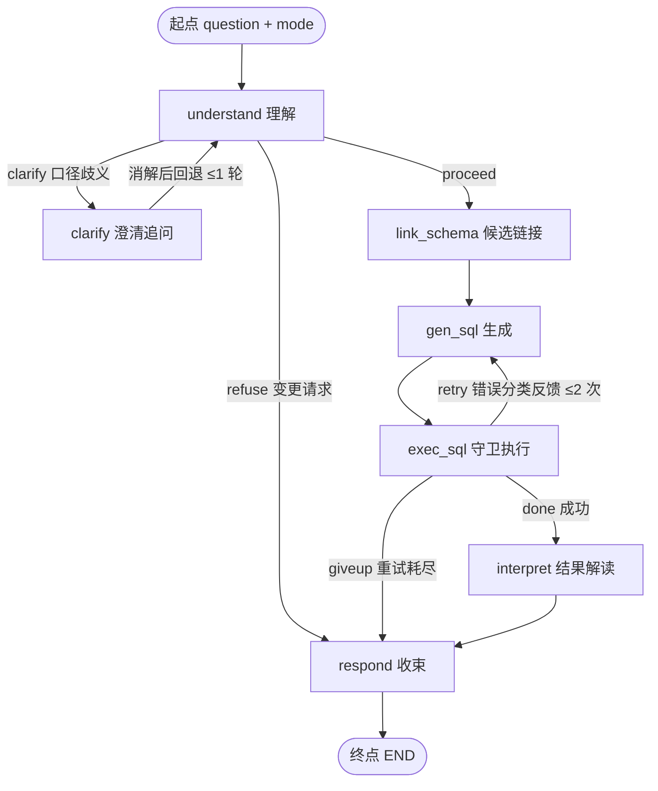

# 编排形式审查 · LangGraph（NL2SQL 多智能体数据分析助手）

> **版本**：v0.1（审查版）｜**日期**：2026-04-14
> **对象**：`src/graph.py`（as-built 骨架，已干跑通过）｜**设计源**：`docs/详细设计.md` §0.2 / §4｜**系统级**：`docs/设计方案.md`
> **用途**：审查 Pipeline 的 LangGraph 实现形式——图拓扑 / 状态 / 节点 / 边与回路 / 运行产物。确认后作为后续施工（步骤 3+）的基准。

---

## 1. 审查摘要（30 秒版）

| 项 | 现状 |
|---|---|
| 形式 | **LangGraph 原生**（`StateGraph`，langgraph 1.2.14）——单图、7 节点、2 组条件边、2 条回路、唯一出口 |
| 结构 | 与设计约定一致：**起点 →（展开：主干 + 回路就近回退）→ 收束（三路汇入 respond）**；无游离终态 |
| 运行 | 双模式（interactive / eval）；每次运行落 trace（节点时延 / 重试 / 澄清轨迹） |
| 验证 | 三路径干跑 **PASS**（澄清 / 重试 / 拒答）——见 §8 |
| 待审 | **§7 六条实现取舍**（均非阻塞；第 2 条含一处"已知局限"的升级位） |

## 2. 形式选择：为什么是 LangGraph

| 备选形式 | 能否表达本 Pipeline | 说明 |
|---|---|---|
| LangChain（LCEL 链式） | × | 链为有向无环：两条**受控回退 + 重入**表达不了；多分支收束（三路汇一）也无标准形态 |
| 手写 while / 递归控制流 | √ | 能跑，但没有标准形态（不可视 / 不可讲）、无节点级状态与轨迹、无中断 / 恢复的演进空间 |
| **LangGraph（本项目选用）** | √ | 状态图天然支持**环与条件边**；节点级轨迹；标准形式可讲述；预留 `interrupt` / 子图演进 |

**组件层边界**：编排 = LangGraph 原生；组件层（LLM 客户端 / 检索 / 索引）保持轻量自研（OpenAI 兼容 SDK + numpy 索引），未引入 LangChain 家族依赖（避免重依赖与抽象噪音）。

## 3. 图拓扑（as-built）



文字版（对应设计 §0.2「起点 → 展开 → 收束」）：

```
【起点】START → understand（单入口：question + mode）
【展开】主干：understand ─proceed→ link_schema → gen_sql → exec_sql → interpret
   回路 A：understand ─clarify→ clarify ─消解后回退→ understand（≤1 轮；超限按默认口径继续）
   回路 B：exec_sql ─retry→ gen_sql（携带错误分类反馈；≤2 次）
【收束】respond（唯一出口）← 正常：interpret ｜ 降级：exec_sql giveup ｜ 拒答：understand refuse
   respond → END
```

## 4. 状态契约（State，as-built）

| 分组 | 字段 | 写入者 | 用途 |
|---|---|---|---|
| 输入 | `question` / `mode` | 入口 | 问题原文；interactive / eval 双模式 |
| 理解 | `metric_hits` / `ambiguity` / `refuse_hit` | understand | 指标命中、歧义组、变更意图（拒答） |
| 澄清 | `clarified` / `clarify_count` / `clarify_info` | clarify | 澄清答案与计数（≤1 轮） |
| 检索 | `candidate_schema` / `few_shots` | link_schema | 候选表 / 字段与示例 |
| 生成执行 | `sql` / `error` / `error_type` / `retries` / `retry_history` / `exec_ok` / `columns` / `rows` | gen_sql / exec_sql | SQL 与错误协议、执行结果 |
| 输出与观测 | `answer` / `path` / `done` / `node_log` / `timings` | interpret / respond / timed 包装 | 最终输出、路径标记、节点轨迹与耗时 |

> 观测两字段（`node_log` / `timings`）为"读-合并-写"累积（见 §7-5）。

## 5. 节点与边（as-built）

### 5.1 节点（7 个，均带计时包装）

| 节点 | 职责（一句） | 设计对应 |
|---|---|---|
| `understand` | 指标识别 + 歧义检测 + 变更意图识别（拒答判定） | §4.2 / §1.1 |
| `clarify` | 追问并记录答案（interactive 真问 / eval 走默认口径） | §6 |
| `link_schema` | 候选表 / 字段压缩 + few-shot 选择 | §2 / §3 |
| `gen_sql` | 组装提示（schema + 口径 + 示例 + 问题 + 错误反馈）→ 生成 SQL | §4.2 |
| `exec_sql` | guard 校验 → 只读执行 → 错误分类 | §5 / §4.3 |
| `interpret` | 结果解读（空结果兜底） | §4.2 |
| `respond` | 唯一出口：正常 / 降级 / 拒答三路收束 | §4.3 |

### 5.2 边

**静态边（5 条）**：`clarify → understand`｜`link_schema → gen_sql`｜`gen_sql → exec_sql`｜`interpret → respond`｜`respond → END`

**条件边①（understand 出口，3 路由）**：

```python
def route_understand(state) -> str:
    if state.get("refuse_hit"):  return "refuse"   # 变更类请求 → respond（拒答收束）
    if state.get("ambiguity"):   return "clarify"  # 口径歧义 → clarify（回路 A）
    return "proceed"                                # 主干推进 → link_schema
```

**条件边②（exec_sql 出口，3 路由）**：

```python
def route_exec(state) -> str:
    if state.get("exec_ok"):                    return "done"    # → interpret
    if state.get("retries", 0) < max_retries:   return "retry"   # → gen_sql（回路 B）
    return "giveup"                                              # → respond（降级）
```

### 5.3 回路约束（防死循环）

| 回路 | 回退点 | 约束 | 超限行为 |
|---|---|---|---|
| A · 澄清 | 回 `understand`（重判定） | ≤1 轮（`clarify.max_rounds`） | 按默认口径继续主干 |
| B · 重试 | 回 `gen_sql`（保留链接与 few-shot 产物） | ≤2 次（`retry.max_retries`） | `giveup` → respond 降级收束 |

### 5.4 图定义（核心代码）

```python
g = StateGraph(State)
g.add_node("understand", timed("understand", understand))
g.add_node("clarify", timed("clarify", clarify))
g.add_node("link_schema", timed("link_schema", link_schema))
g.add_node("gen_sql", timed("gen_sql", gen_sql))
g.add_node("exec_sql", timed("exec_sql", exec_sql))
g.add_node("interpret", timed("interpret", interpret))
g.add_node("respond", timed("respond", respond))
g.set_entry_point("understand")
g.add_conditional_edges("understand", route_understand,
                        {"refuse": "respond", "clarify": "clarify", "proceed": "link_schema"})
g.add_edge("clarify", "understand")
g.add_edge("link_schema", "gen_sql")
g.add_edge("gen_sql", "exec_sql")
g.add_conditional_edges("exec_sql", route_exec,
                        {"done": "interpret", "retry": "gen_sql", "giveup": "respond"})
g.add_edge("interpret", "respond")
g.add_edge("respond", END)
return g.compile()
```

## 6. 运行与产物

- 跑一次：`run(question, mode, llm, ask, db_path, save_sample)` → `{trace, final, trace_file}`；
- 干跑：`python -m src.graph`（三路径演示）；CLI：`python app.py --mock / --eval "问题"`；
- trace 落 `runs/`（脚本路径样本在 `runs/samples/`：clarify / retry / refuse 三份）；
- trace 结构：question / mode / nodes（每节点耗时与摘要）/ clarify / retries（错误分类与 SQL）/ final（path / sql / rows_n / answer）/ timings。

## 7. 设计取舍记录（六条）

1. **回路 A 的回退点 = `understand`（重判定）**，而非直连 `link_schema`。
   理由：澄清补入了新语义（口径消解），需要重新理解；该结构同时为未来多轮澄清留了位置。→ **建议确认**。
2. **回路 B 的回退点 = `gen_sql`（就近回退）**，保留链接与 few-shot 产物。
   **边界条件**：若失败根因是"候选表缺失"（`exec:no_such_table` 且目标表不在候选集），重生成无法自愈。**升级位**：错误分类为链接类且第 1 次重试未果时，允许回退 `link_schema` 重检索。**启用条件**：真实 LLM 跑出足够错误分布后按数据决定（步骤 6+）。
3. **澄清交互形式 = 回调 `ask()`**（interactive 真交互 / eval 走默认口径、可批量干跑）。
   LangGraph 原生的人机交互形式是 `interrupt` + checkpointer（可中断、可恢复、跨进程）——**列为 M4 升级候选**（多轮场景与评测期再评估）。当前形式不阻塞任何功能。→ **建议确认**。
4. **"多智能体"的形态 = 单图多节点**：节点各自专职 + 独立提示词；模型角色（生成 / Judge / Embedding / 轻量档）在配置层区分。
   若希望更重的形式（**子图化** / 每节点独立 Agent 类包装），**此轮提出成本最低**（图结构冻结前）；冻结后再改代价高。→ 采纳单图多节点。
5. **观测方式 = 读-合并-写**（`node_log` / `timings` 由节点手动合并），未引入 State reducer（`Annotated`）。
   保持简单可读；如需 reducer 风格可切换，行为不变。→ 维持现状。
6. **组件层边界**：编排层 = LangGraph 原生；组件层 = 轻量自研（未引入 LangChain 家族依赖）。
   组件层维持轻依赖，不引入 LangChain 家族包。→ 维持现状。

## 8. 验证记录（2026-04-14 复验）

| 路径 | 结果 | 记录 |
|---|---|---|
| 澄清（金额歧义 → 追问 → 消解生成） | `normal` √ | `runs/samples/clarify_path.json` |
| 重试（首轮错表名 → `exec:no_such_table` → 修正成功） | `normal`（重试 1 次）√ | `runs/samples/retry_path.json` |
| 拒答（"删掉订单" → 变更意图 → 拒答收束） | `refuse` √ | `runs/samples/refuse_path.json` |

环境：langgraph 1.2.14（Windows / Py3.13）；全链干跑 PASS。

## 9. 与后续施工的关系

- **图结构冻结原则**：步骤 3-5（Linking / few-shot / 口径实装）**只替换节点内部实现，图拓扑不动**——节点签名与状态字段已按本形式固定；
- 图结构层面的变更（如第 2 条升级位启用、第 4 条子图化）→ 走本审查记录后实施；
- 讲述口径：被问"编排怎么做的"，按 **起点 → 展开（回路就近回退）→ 收束（唯一出口）** 讲。
